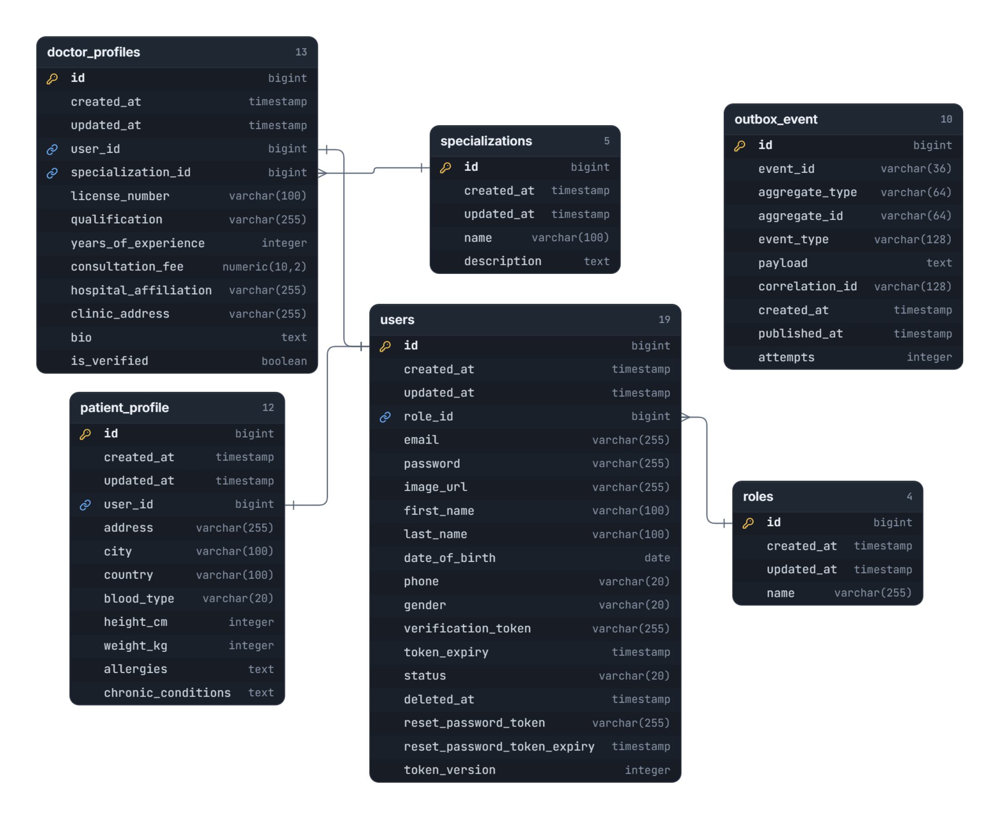
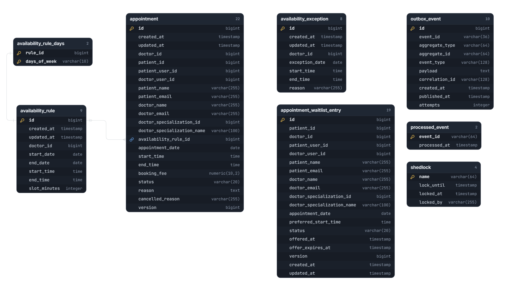
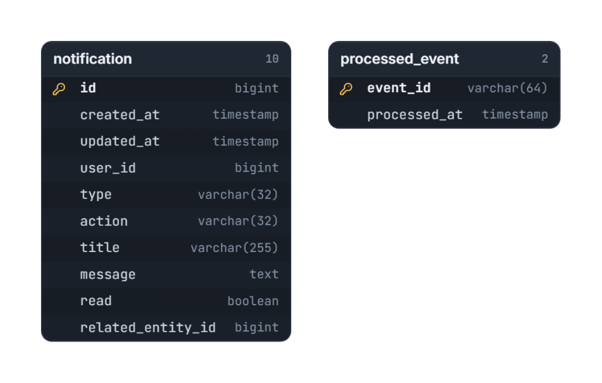
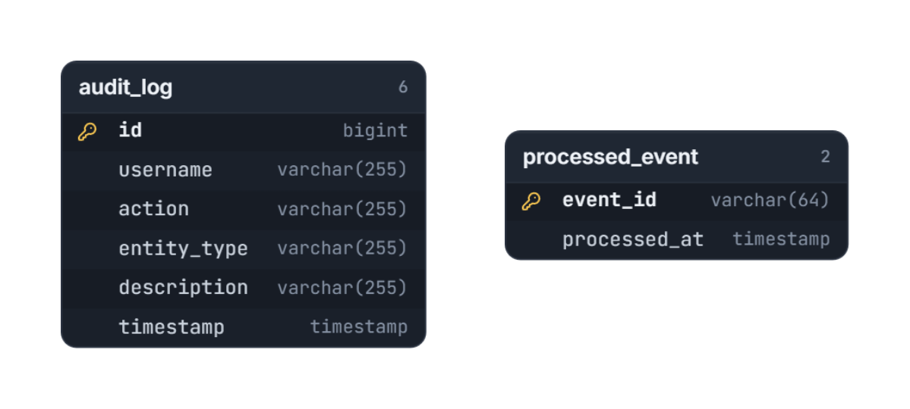

# Medic - Medical Appointment Booking Platform

## Project Information

Medic is a comprehensive backend application designed to manage medical appointments between doctors and patients. It
serves as a secure, role-based platform where patients can find doctors, view their availability, and book appointments,
while doctors can manage their schedules, availability rules, and appointment history.

### Main Features

- **Role-Based Access Control:** Distinct roles for Patients, Doctors, and Administrators.
- **Secure Authentication:** JWT-based authentication with email verification and password recovery.
- **Profile Management:** Users can manage their profiles and upload avatars.
- **Advanced Booking System:** Real-time availability calculation based on doctor-defined schedules and exceptions, with
  transaction-safe booking, rescheduling, and double-booking prevention.
- **Priority Appointment Waitlist:** Patients can queue for one exact booked slot. When it is released, the earliest
  eligible patient receives a 15-minute offer that reserves the slot until accepted, declined, or expired.
- **Real-Time & Email Notifications:** Booking events reach `notification-service` through Kafka. See
  [notification-service/README.md](notification-service/README.md).
- **Security & Reliability:** Global exception handling, gateway Redis rate limiting, and comprehensive audit logging.
- **API Documentation:** Interactive Swagger/OpenAPI documentation.

## Live Deployment

Medic runs on AWS: the frontend on S3 and CloudFront, the backend on Elastic Beanstalk with an RDS database, and images
stored in ECR. Jenkins builds, tests and deploys every push to `main`.

| Surface         | URL                                                                           |
|-----------------|-------------------------------------------------------------------------------|
| Frontend        | https://d4405qjwlfxlp.cloudfront.net/                                         |
| Backend API     | https://d27j77oo959eqd.cloudfront.net/                                        |
| Frontend source | [MariamBaloch/medic_frontend](https://github.com/MariamBaloch/medic_frontend) |

These AWS addresses may be taken offline after the course ends. To run the project yourself, follow
[Run locally](#run-locally). Full deployment details are in [docs/DEPLOYMENT.md](docs/DEPLOYMENT.md).

## Demo Credentials

For local runs, the application is pre-seeded with sample data so you can test the endpoints without registering new
accounts. These accounts are created by the seed data and are for local use only.

| Role    | Email                | Password  |
|---------|----------------------|-----------|
| Admin   | `admin@medic.com`    | `Potato!` |
| Doctor  | `doctor1@medic.com`  | `Potato!` |
| Doctor  | `doctor2@medic.com`  | `Potato!` |
| Patient | `patient1@medic.com` | `Potato!` |
| Patient | `patient2@medic.com` | `Potato!` |
| Patient | `patient3@medic.com` | `Potato!` |

## Technologies

**Application**

- **Java 17**
- **Spring Boot 4.1.1**
- **Spring Cloud Gateway Server WebMVC 5.0.4** as the public edge (`gateway-service`)
- **Spring Web MVC** for REST APIs (`booking-service`, `identity-service`, `notification-service`, `audit-service`)
- **Spring Security** for authentication and role-based authorization
- **JJWT** for JWT creation and validation
- **Spring Data JPA** for persistence
- **PostgreSQL** as the main relational database
- **PostgreSQL advisory transaction locks and partial unique indexes** for slot-level concurrency protection
- **Flyway** per service, each in its own Postgres schema (`identity`, `booking`, `notification`, `audit`)
- **Spring Data JPA Specifications and Pageable** for waitlist filtering and pagination
- **Spring Validation** for request validation
- **Spring Mail** for email delivery
- **Thymeleaf** for styled HTML email templates
- **Spring Data Redis** for token blacklist, token version, the booking schedule-cache version, and gateway rate
  limiting
- **Apache Kafka (KRaft)** with a transactional outbox and dead-letter topics
- **ShedLock** so the waitlist expiry job runs on one booking instance
- **Bucket4j** with Redis support for gateway rate limiting
- **Spring AOP** for cross-cutting concerns such as audit logging
- **Spring Boot Actuator** for health/monitoring endpoints
- **Springdoc OpenAPI / Swagger UI** for API documentation
- **MapStruct** for DTO/entity mapping
- **Lombok** for reducing boilerplate
- **Server-Sent Events (SSE)** for real-time notifications
- **Java `ThreadPoolExecutor`** for bounded post-commit email dispatch **Testing**

- **JUnit**, **Spring Boot Test**, and **Cucumber** for testing
- **H2** for business-logic and booking Cucumber tests, and **Testcontainers** for PostgreSQL concurrency tests **Build,
  delivery and infrastructure**

- **Maven** for dependency management and builds
- **Docker** and **Docker Compose** for containers and local and production stacks
- **Jenkins** for the CI/CD pipeline
- **AWS:** Elastic Beanstalk (backend), RDS PostgreSQL (database), ECR (container images), S3 and CloudFront (frontend,
  and the HTTPS address in front of the backend)

## Architecture

The repository is a Maven multi-module layout. Services are the running applications. Libraries are shared code with no
port.

```text
Browser
   |
   v
gateway-service (8080)  -- routing, CORS, rate limiting, correlation IDs
   |
   +--> identity-service (8082)       accounts, profiles, JWT issuing
   +--> booking-service (8081)        availability, appointments, waitlist
   +--> notification-service (8084)   in-app notifications, SSE, email
   +--> audit-service (8085)          append-only audit log
 
Redis  : token blacklist and versions, schedule-cache version, rate limiting
Kafka  : events between services (transactional outbox, dead-letter topics)
Postgres: one database "medic", one schema and one database user per service
```

### Services

| Module                 | Port | Responsibility                                                    | README                                   |
|------------------------|------|-------------------------------------------------------------------|------------------------------------------|
| `gateway-service`      | 8080 | Public entry: routing, CORS, Redis rate limiting, correlation IDs | [README](gateway-service/README.md)      |
| `booking-service`      | 8081 | Availability, appointments, waitlist, schedule cache              | [README](booking-service/README.md)      |
| `identity-service`     | 8082 | Auth, users, profiles, specializations, doctor directory          | [README](identity-service/README.md)     |
| `notification-service` | 8084 | In-app notifications, SSE, email                                  | [README](notification-service/README.md) |
| `audit-service`        | 8085 | Append-only audit log                                             | [README](audit-service/README.md)        |

### Libraries

| Module            | Responsibility                                               | README                              |
|-------------------|--------------------------------------------------------------|-------------------------------------|
| `medic-common`    | Event contracts, topic names, snapshot records               | [README](medic-common/README.md)    |
| `medic-security`  | JWT validation, Redis token checks, internal API key         | [README](medic-security/README.md)  |
| `medic-messaging` | Transactional outbox, processed events, dead-letter handling | [README](medic-messaging/README.md) |
| `medic-web`       | Shared error body, page shape, correlation id                | [README](medic-web/README.md)       |

Public clients keep using `http://localhost:8080` locally. One Postgres database, `medic`, is shared. Isolation is a
role and a schema per service, not a database per service. How availability is calculated, how a slot is locked, and
how a booking becomes a notification are in the [booking](booking-service/README.md)
and [notification](notification-service/README.md) READMEs. Production Compose is
[`deploy/docker-compose.prod.yml`](deploy/docker-compose.prod.yml).

## Database schemas

One Postgres database, `medic`, with a schema per service. There is no foreign key from a booking row to an identity
table. `doctor_id` and `patient_id` are copied profile ids.

### Identity Schema



### Booking Schema



### Notification Schema



### Audit Schema



## API Documentation

Interactive Swagger documentation is served by each API service, through the gateway:

- Identity: `http://localhost:8080/api/identity/swagger-ui.html`
- Booking: `http://localhost:8080/api/booking/swagger-ui.html`
- Notification: `http://localhost:8080/api/notification/swagger-ui.html`
- Audit: `http://localhost:8080/api/audit/swagger-ui.html`
  The `prod` profile disables these pages, so they are not available on the deployed backend. The gateway has no Swagger
  UI.

## Run locally

Requirements: Docker with Docker Compose. Java 17 is only needed to run the tests or to run a service outside Docker.

1. **Clone the repository:**

```bash
git clone <repository-url>
cd medic
```

2. **Configure the environment:**
   Copy the example and fill in the secrets. `.env` is git-ignored, so your secrets are never committed.

```bash
cp .env.example .env
```

Generate a strong secret with `openssl rand -base64 32`. Compose refuses to start if a required secret is empty.

3. **Start the full stack:**

```bash
docker compose up --build
```

This starts Postgres, Redis, Kafka, Mailpit, the four services and the gateway. The first start also creates the
`medic` database, the service roles and the four schemas. Each service's Flyway then creates its own tables, and the
identity seed loads the demo users and specializations.

4. **Use the application:**
    - API base URL: `http://localhost:8080` (gateway)
    - Booking via gateway: `http://localhost:8080/api/booking/...`
    - Identity via gateway: `http://localhost:8080/api/identity/...`
    - Emails sent by the application appear in Mailpit: `http://localhost:8025`
      Optional: add `--profile ui` to also start Kafka UI.

**Running a service outside Docker (for development).** Start the dependencies with Compose
(`docker compose up postgres redis kafka kafka-init mailpit`), then run the service you are working on:

```bash
./mvnw -pl identity-service spring-boot:run
./mvnw -pl booking-service spring-boot:run
./mvnw -pl gateway-service spring-boot:run
```

The service needs the same environment variables as in `.env.example`.

## Testing

H2 tests cover business workflows. PostgreSQL/Testcontainers tests cover constraints and concurrency (Docker required).
Booking Cucumber covers booking, cancellation, anonymous access, health, and a ten-patient race for one slot. The
gateway has route, CORS, proxy, and rate-limit rule tests. Run the suite with `./mvnw test` (or `./mvnw verify`, as the
pipeline does); see the [Concurrency Guide](docs/CONCURRENCY.md) for details.

## CI/CD

The `Jenkinsfile` defines the pipeline. A push to `main` runs these stages in order, and a failure stops the later ones:

1. **Build and test** with `./mvnw verify`.
2. **Build images** for the five services with Docker Compose, tagged with the short Git commit hash.
3. **Push to ECR** under `medic/<service>:<commit>`.
4. **Deploy to Beanstalk** with the production Compose file.
5. **Verify** that `/actuator/health` answers on the deployed backend.
   No secrets are stored in the repository. Runtime secrets are Elastic Beanstalk environment properties, and the AWS
   keys
   used by the pipeline are Jenkins credentials. See [docs/DEPLOYMENT.md](docs/DEPLOYMENT.md) for the AWS setup.

## Project Planning and User Stories

Project 3 is in [`docs/Project_3_Planning.md`](docs/Project_3_Planning.md). The two-week service split is in
[`docs/Project_4_Planning.md`](docs/Project_4_Planning.md). User stories and project tracking are maintained on the
[Medic Trello board](https://trello.com/b/9VwIYDT1/medic).

## Major Challenges

- **Availability Engine:** Calculating precise 15-minute appointment slots based on dynamic weekly schedules while
  excluding specific date/time exceptions and already booked appointments proved mathematically and logically
  challenging.
- **Concurrency Control:** Preventing duplicate bookings and patient overlaps required coordinating patient and
  exact-slot advisory locks, optimistic versions, and PostgreSQL constraints.
- **Waitlist Priority:** Releasing a slot and offering it to the next eligible patient had to remain atomic with booking
  operations so an ordinary request could not take a slot during an active offer.
- **Service split:** Booking could no longer read identity tables. Snapshots, a claims JWT, and a keyed internal API
  replaced the old in-process calls.
- **Reliable messaging:** Events must not be lost or applied twice. A transactional outbox, idempotent consumers and
  dead-letter topics cover this.
- **Deployment on a small budget:** The whole system runs on one Elastic Beanstalk instance with Redis and Kafka as
  containers, and a private RDS database. Memory limits and a separate HTTPS address for the backend were needed to
  make that work.

## Future Improvements

- **Broader API Testing:** Extend Cucumber and the PostgreSQL suites to more waitlist and notification cases.
- **More than one booking instance:** Run two booking replicas against one database and show ShedLock and the slot lock
  under parallel requests.
- **Managed messaging and encryption in transit:** Replace the single Kafka container with a managed service, and
  encrypt the last hop between CloudFront and the backend with a load balancer and certificate.

## Credits & Resources

- Email Verification
  Flow: [Alexander Obregon](https://medium.com/@AlexanderObregon/email-verification-flows-with-spring-boot-and-expiring-tokens-e9b2a238d917)
- MapStruct Integration: [Baeldung](https://www.baeldung.com/mapstruct)
- AOP Logging: [Baeldung](https://www.baeldung.com/spring-aspect-oriented-programming-logging)
- Global Exception
  Handling: [Roshan Farakate](https://medium.com/@roshanfarakate/global-exception-handling-in-spring-boot-712593159a26)
- Java Constants Best
  Practices: [Santiago Barbieri](https://medium.com/@barbieri.santiago/java-constants-best-practices-648fc562bb08)
- Spring REST OpenAPI Documentation: [Baeldung](https://www.baeldung.com/spring-rest-openapi-documentation)
- JWT Logout &
  Redis: [GitConnected](https://levelup.gitconnected.com/invalidate-blacklist-the-jwt-using-redis-logout-mechanism-in-spring-security-86b23149699a)
- Rate Limiting with
  Bucket4j: [Medium](https://medium.com/@prajpatil29/implementing-rate-limiting-with-redis-and-spring-boot-a-deep-dive-0bd000bcd98c)
- Server-Sent Events
  (SSE): [Medium](https://medium.com/@vishalpriyadarshi/real-time-event-streaming-in-spring-boot-using-server-sent-events-sse-a-guide-for-modern-f1048d3f5796)
- Spring Data JPA Specification: [Dev.to](https://dev.to/saladlam/spring-data-jpa-about-specification-interface-56ed)
- AI assistance: [OpenAI ChatGPT](https://chatgpt.com/) and [Anthropic Claude](https://claude.ai/) were used for
  learning, planning, review and code enhancement; suggestions were reviewed against the application.
 