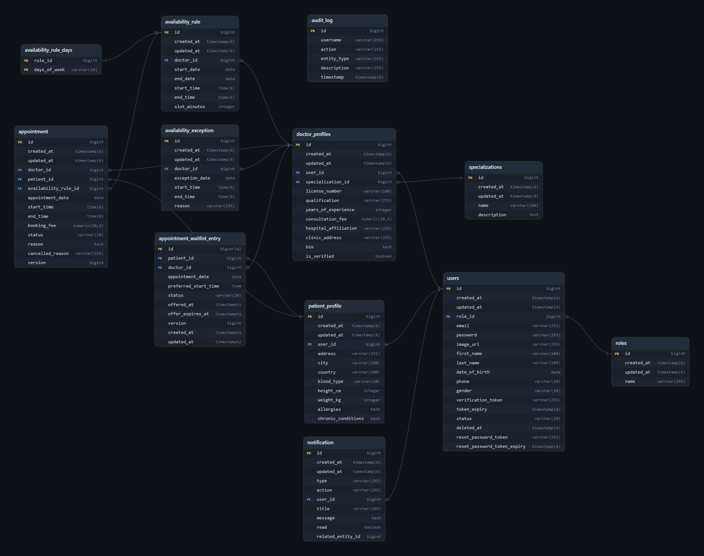

# Medic - Medical Appointment Booking Platform

## Project Information

Medic is a comprehensive backend application designed to manage medical appointments between doctors and patients. It
serves as a secure, role-based platform where patients can find doctors, view their availability, and book appointments,
while doctors can manage their schedules, availability rules, and appointment history.

### Main Features

- **Role-Based Access Control:** Distinct roles for Patients, Doctors, and Administrators.
- **Secure Authentication:** JWT-based authentication with email verification and password recovery.
- **Profile Management:** Users can manage their profiles and upload avatars.
- **Advanced Booking System:** Real-time availability calculation based on doctor-defined schedules and exceptions, with
  transaction-safe booking, rescheduling, and double-booking prevention.
- **Priority Appointment Waitlist:** Patients can queue for one exact booked slot. When it is released, the earliest
  eligible patient receives a 15-minute offer that reserves the slot until accepted, declined, or expired.
- **Real-Time & Email Notifications:** Server-Sent Events (SSE) push notifications for appointment updates, with
  matching styled email notifications dispatched after the business transaction commits.
- **Security & Reliability:** Global exception handling, API rate limiting using Redis, and comprehensive audit logging.
- **API Documentation:** Interactive Swagger/OpenAPI documentation.

## Demo Credentials

The application is pre-seeded with sample data to allow you to easily test the endpoints without needing to register new
accounts.

| Role    | Email                | Password  |
|---------|----------------------|-----------|
| Admin   | `admin@medic.com`    | `Potato!` |
| Doctor  | `doctor1@medic.com`  | `Potato!` |
| Patient | `patient1@medic.com` | `Potato!` |

## Technologies

- **Java 17**
- **Spring Boot 4.1.1**
- **Spring Web MVC** for REST APIs
- **Spring Security** for authentication and role-based authorization
- **JJWT** for JWT creation and validation
- **Spring Data JPA** for persistence
- **PostgreSQL** as the main relational database
- **Spring Validation** for request validation
- **Spring Mail** for email delivery
- **Thymeleaf** for styled HTML email templates
- **Spring Data Redis** for Redis integration
- **Bucket4j** with Redis support for rate limiting
- **Spring AOP** for cross-cutting concerns such as audit logging
- **Spring Boot Actuator** for health/monitoring endpoints
- **Springdoc OpenAPI / Swagger UI** for API documentation
- **MapStruct** for DTO/entity mapping
- **Lombok** for reducing boilerplate
- **Server-Sent Events (SSE)** for real-time notifications
- **JUnit** and **Spring Boot Test** for testing
- **Spring Boot DevTools** for local development
- **Maven** for dependency management and builds

## Architecture

The application follows a clean-layered architecture:

- **Controllers:** Handle incoming HTTP requests and define API endpoints.
- **Services:** Contain the core business logic (e.g., availability calculation, booking validation).
- **Repositories:** Manage data persistence using Spring Data JPA.
- **Database:** PostgreSQL for persistent data storage.

Additional architectural components include distinct layers for DTOs, MapStruct Mappers, Security Configurations, Global
Exception Handling, and custom Annotations (e.g., for Audit Logging).

## Booking Engine Design

The appointment booking system utilizes a highly efficient **rule-based engine** rather than a naive date-generation
model.

### Why Rule-Based?

A naive approach (generating and storing rows for every possible 15-30 minute slot for the next 5 years or even 3
months) would result in a massive database footprint (millions of rows per doctor) and slow query performance.

Instead, the **Rule-Based Engine** models availability conceptually:

- **`AvailabilityRule`:** Defines a recurring schedule (e.g., "Monday and Wednesday, 9 AM to 5 PM, 30-minute slots, for
  the next 6 months").
- **`AvailabilityException`:** Defines temporary exceptions to the regular availability schedule, such as being sick for
  a day or taking vacation.
- **`Appointment`:** Represents actual booked slots.

When a patient queries a doctor's availability for a given date range, the engine **dynamically calculates** available
slots in real-time by:

1. Fetching all active `AvailabilityRule` for the doctor.
2. Generating a virtual schedule of time slots in memory.
3. Fetching and applying `AvailabilityException`s to cross out unavailable times.
4. Fetching existing `Appointment`s and active waitlist offers to label each valid scheduled slot as `AVAILABLE`,
   `BOOKED`, or `WAITLIST_OFFERED`.
5. Returning valid slots, including booked slots, so a patient calendar can offer waitlist entry where appropriate.

This approach guarantees high performance, negligible storage requirements, and immediate reflection of any schedule
changes.

### Booking Concurrency and Priority Waitlist

- **Booking:** Patient-row locks prevent overlapping bookings; PostgreSQL slot-level advisory locks serialize requests
  for the same slot, and a partial unique index prevents duplicate active appointments.
- **Rescheduling:** `Appointment.version` rejects stale updates; patient and consistently ordered slot locks protect the
  change, and a failed reschedule preserves the original appointment.
- **Waitlist:** Partial unique indexes prevent duplicate active entries and multiple offers for one slot. Released slots
  are offered in queue order for 15 minutes; active offers block ordinary bookings, while decline or expiry advances the
  queue.

See the [Concurrency Guide](docs/CONCURRENCY.md) for implementation details.

### Appointment Notification Delivery

Appointment notifications are saved in the same transaction as the booking, rescheduling, or cancellation. After the
transaction commits, Medic sends real-time updates through SSE and schedules emails using a thread pool (2 core threads,
up to 4, with a queue for 100 tasks).

## Project Planning and User Stories

The implementation plan is in [`docs/Project_3_Planning.md`](docs/Project_3_Planning.md). User stories and project
tracking are maintained on the [Medic Trello board](https://trello.com/b/9VwIYDT1/medic).

## Entity Relationship Diagram (ERD)

The database schema was designed to cleanly separate user authentication data from profile-specific data and booking
logic.



## API Documentation

Interactive Swagger documentation is available at `http://localhost:8080/swagger-ui.html` when the application is
running.

## Testing

H2 tests cover business workflows; PostgreSQL/Testcontainers tests cover constraints and concurrency (Docker required).
Run the suite with `./mvnw test`; see the [Concurrency Guide](docs/CONCURRENCY.md) for details.

## Installation

Follow these steps to run the application locally:

1. **Clone the repository:**
   ```bash
   git clone <repository-url>
   cd medic
   ```

2. **Configure Services:**
    - Ensure **PostgreSQL** is running on your system (default port 5432).
    - Ensure **Redis** is running on your system (default port 6379).
    - Create a PostgreSQL database named `medic`.

3. **Environment Variables:**
   Create a `.env` file in the root directory based on `.env.example`:
   ```properties
   SPRING_PROFILE=dev
   JWT_SECRET=your_super_secret_key_needs_to_be_long_enough
   JWT_EXPIRATION=86400000
   DB_URL=jdbc:postgresql://localhost:5432/medic
   DB_USERNAME=postgres
   DB_PASSWORD=your_password
    MAIL_USERNAME=your_email@gmail.com
    MAIL_PASSWORD=your_app_password
    APP_BASE_URL=http://localhost:8080
    REDIS_HOST=localhost
    REDIS_PORT=6379
    ```

4. **Start the Application:**
   Run the application using Maven:
   ```bash
   ./mvnw spring-boot:run
   ```

5. **Seed the Database:**
   The application will automatically initialize the database structure and seed roles and specializations from
   `src/main/resources/data.sql`.

6. **Access the Application:**
    - API Base URL: `http://localhost:8080`
    - Swagger UI: `http://localhost:8080/swagger-ui.html`

## Major Challenges

- **Availability Engine:** Calculating precise 15-minute appointment slots based on dynamic weekly schedules while
  excluding specific date/time exceptions and already booked appointments proved mathematically and logically
  challenging.
- **Concurrency Control:** Preventing duplicate bookings and patient overlaps required coordinating patient-row locks,
  exact-slot advisory locks, optimistic versions, and PostgreSQL constraints.
- **Waitlist Priority:** Releasing a slot and offering it to the next eligible patient had to remain atomic with booking
  operations so an ordinary request could not take a slot during an active offer.

## Future Improvements

- **Broader API Testing:** Extend the existing H2 and PostgreSQL/Testcontainers suites to cover additional availability,
  booking, and waitlist edge cases.
- **Redis Caching for Availability:** Optimize performance by caching the results of `computeAvailableSlots` in Redis.
  This cache will be strategically invalidated and refreshed only when a doctor updates their availability rules or
  exceptions.
- **Durable Email Delivery:** Add a transactional outbox and retry mechanism so committed notifications can be emailed
  after a process restart or temporary mail-service failure.

## Credits & Resources

- Email Verification
  Flow: [Alexander Obregon](https://medium.com/@AlexanderObregon/email-verification-flows-with-spring-boot-and-expiring-tokens-e9b2a238d917)
- MapStruct Integration: [Baeldung](https://www.baeldung.com/mapstruct)
- AOP Logging: [Baeldung](https://www.baeldung.com/spring-aspect-oriented-programming-logging)
- Global Exception
  Handling: [Roshan Farakate](https://medium.com/@roshanfarakate/global-exception-handling-in-spring-boot-712593159a26)
- Java Constants Best
  Practices: [Santiago Barbieri](https://medium.com/@barbieri.santiago/java-constants-best-practices-648fc562bb08)
- Spring REST OpenAPI Documentation: [Baeldung](https://www.baeldung.com/spring-rest-openapi-documentation)
- JWT Logout &
  Redis: [GitConnected](https://levelup.gitconnected.com/invalidate-blacklist-the-jwt-using-redis-logout-mechanism-in-spring-security-86b23149699a)
- Rate Limiting with
  Bucket4j: [Medium](https://medium.com/@prajpatil29/implementing-rate-limiting-with-redis-and-spring-boot-a-deep-dive-0bd000bcd98c)
- Server-Sent Events
  (SSE): [Medium](https://medium.com/@vishalpriyadarshi/real-time-event-streaming-in-spring-boot-using-server-sent-events-sse-a-guide-for-modern-f1048d3f5796)
- Spring Data JPA Specification: [Dev.to](https://dev.to/saladlam/spring-data-jpa-about-specification-interface-56ed)
- AI assistance: [OpenAI ChatGPT](https://chatgpt.com/) was used for learning and code enhancement; suggestions were
  reviewed against the application.
